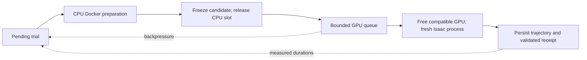

# CPU Harbor → asynchronous remote Isaac

Harbor, the coding agent and the separate verifier run in CPU Docker containers.
The verifier submits one complete rollout to a GPU worker on the existing Anchor
host. PhysX steps stay in the worker process. The CPU polls a job ID and retrieves
the trajectory and result; it does not need CUDA, Isaac, or GPU Docker support.
The GPU host does not need Harbor. GitHub GPU runner registration is independent
of this execution route.

The deployed first workload, `isaac-drop-v1`, is a **transport acceptance fixture**:
a fresh Isaac Sim 5.1 process advances a cube for 120 steps with GPU dynamics.
Normal gravity settles the cube on the floor (score 1); zero gravity leaves it
aloft (score 0). This is not an EmbodiedSWE task, model trial, or benchmark score.
The API currently accepts numeric parameters only. Submitted Python is **not**
executed on the shared host. EmbodiedSWE's `solve(env)` requires a separately
registered isolated execution backend, pinned scene/runtime and native grader;
its no-op and protocol-parity gates remain pending.

## Runtime contract

- `POST /jobs` with `Authorization: Bearer …` and `Idempotency-Key: …` returns a
  job ID immediately. Reusing a key with the same request returns that job;
  reusing it with different data is rejected.
- `GET /jobs/<id>` returns `queued`, `running`, `succeeded`, `failed`, `cancelled`
  or `timed_out`. Successful jobs include the trajectory and physical outcome.
- `GET /jobs/<id>/log?offset=0` returns at most 64 KiB and the next byte offset.
- `POST /jobs/<id>/cancel` cancels queued work or requests process-group cleanup.
  A running job becomes terminal only after cleanup completes.
- `GET /health` lists enabled GPUs, registered workloads, queue occupancy,
  per-lane running jobs and the measured rollout duration estimate; it requires auth.

SQLite persists job state and idempotency keys. A restart marks interrupted jobs
failed rather than silently replaying them. Queue waits expire after ten minutes;
native execution is limited to five minutes. Each GPU has one worker, and each
rollout holds Anchor's existing `anchor-robodojo-gpu-N.lock`. A busy Anchor lane
leaves the request queued. The native child inherits the lock, preserving exclusion
if the supervisor is killed. Timeout/cancel reaps the process group before release.

## CPU/GPU scheduling

The implementation is a bounded pipeline in [pipeline.py](pipeline.py) and a
non-preemptive GPU dispatcher in [scheduling.py](scheduling.py). The scheduling
unit is one complete rollout. Simulation steps stay local to Isaac.



Requests may use `"gpu":"auto"` and include
`"scheduling":{"trial":"codex-task-01","phase":"feedback"}`. Integer GPU
affinity and old requests remain supported. `trial` and `phase` must be assigned
by the trusted dispatcher; the agent does not receive the service token. Fairness
is between `(owner, trial)` groups, so giving each checkpoint a new trial ID would
defeat it. `assigned_gpu` is recorded separately without changing the frozen
request or its digest.

* **CPU admission.** With G enabled GPUs, measured mean CPU preparation time C
  and GPU occupation time S, the target producer count is
  `min(configured_cpu_slots, max(1, ceil(G*C/S)+1))`. Before samples exist, use the
  configured ceiling. This is a heuristic with one spare producer for jitter;
  it is not a throughput guarantee. The CPU limit must fit both cores and RAM.
* **Backpressure.** Stop starting CPU preparations when queued plus locally ready
  candidates reaches `2*G`. Preparations already running can finish, so reserve
  space for them: at most `3*G + configured_cpu_slots` local items are in flight.
  Remote occupancy is checked before admission. The service additionally caps
  active jobs at 32 and each named trial at four. Overload returns HTTP 429 with
  `Retry-After`; retries retain the same request and idempotency key. Multiple
  independent dispatchers share the hard server cap; health credits are advisory,
  not distributed reservations.
* **GPU choice.** A free GPU selects eligible work only after checking Anchor's
  shared lock. `auto` requests can run on any enabled, available lane; one busy
  lane does not block another. This does not enable additional GPUs by itself.
* **Feedback latency and final progress.** Prefer feedback, but after three
  consecutive feedback dispatches select an eligible final replay. Within a
  phase, select the trial with the least charged GPU time. Running work is charged
  an estimated duration at dispatch and reconciled to actual elapsed time after
  process cleanup. Service charges survive restart. An interrupted process retains
  its reservation estimate because its actual end time is unknown. After 120 s
  waiting, oldest-first overrides preference and service debt. The 3:1 policy is
  a dispatch share, not a time reservation; a running rollout is never preempted.
* **Independent resources.** `prepare(item)` finishes Docker cleanup before
  returning a frozen request. GPU submission/polling holds no CPU preparation
  slot. The included fixture limits each container to one CPU and 256 MiB. Real
  model integrations must set their own memory, CPU and execution deadlines.
* **Recovery.** The CPU journal is atomically persisted and locked to one writer.
  An accepted submission with a lost reply is recovered using its stable key.
  Restart resumes pending GPU queries; it never silently reruns an interrupted
  paid CPU preparation. A prolonged disconnect leaves the journal resumable.
  To cancel remote work explicitly, use the saved job IDs and `client.py cancel`;
  interrupting the dispatcher alone does not cancel remote jobs. Terminal GPU
  failures remain infrastructure errors; a valid zero score is a successful run.

The current pipeline integrates the **numeric Docker acceptance fixture**. Harbor's
long-lived agent sessions, iterative feedback RPC, isolated EmbodiedSWE backend
and native replay grading are still pending. For that integration, keep the agent
workspace/conversation while it awaits feedback; release its active CPU permit
but continue charging resident RAM. Resume it when the result arrives. At final
delivery, archive artifacts and destroy the agent container before replay grading.
Do not pause or extend upstream's 14,400 s agent wall-clock budget while queued.
If queue delay changes the evaluation conditions materially, record that fact in
the run manifest and validate parity before claiming comparable results.

Cache immutable images, worlds and assets, but retain a **fresh simulator process
per graded rollout**. Reusing live Isaac environments risks state leakage and
would require separate parity evidence. Scheduling changes do not merge distinct
checkpoint/seed executions or add model retries. The two-minute aging and five-
minute execution defaults here belong to the transport fixture, not to the
upstream 30-minute EmbodiedSWE rollout protocol.

### Run the pipeline fixture

Use a locally available Python image pinned by digest, a current deployed service,
and a manifest such as:

```json
[
  {"id":"a","trial":"codex-a","phase":"feedback","parameters":{"steps":120,"gravity":9.81,"initial_height":1.0}},
  {"id":"b","trial":"claude-b","phase":"final","parameters":{"steps":120,"gravity":0,"initial_height":1.0}}
]
```

```bash
python tools/anchor-gpu/remote/batch_fixture.py \
  --manifest runs/remote-isaac/manifest.json \
  --journal runs/remote-isaac/batch.json --cpu-slots 2 \
  --image python@sha256:<local-image-digest> \
  --token-file runs/remote-isaac/token
```

Repeat the exact command to resume the same batch. Use a new journal for an
explicit new attempt. Journals include CPU start/end timestamps, GPU queue and
execution time, GPU assignment, immutable request digest, job ID and receipt.
The fixture produces no benchmark leaderboard result.

The [2026-11-08 live receipt](evidence/pipeline-acceptance-20261108.json) records
four CPU Docker preparations and four fresh Isaac processes on GPU 0: all requests
succeeded, both gravity-on cases scored 1 and both zero-gravity cases scored 0.
Total batch time was 111.895 s, including 102.361 s of GPU-lane occupation. The
three gaps between GPU jobs were 8.8, 9.7 and 11.4 ms (GPU-host clock only).
These measure dispatch handoff, not Isaac startup time or hardware utilization.
Resuming the same completed journal returned the same four job IDs without new
CPU preparations or GPU executions. Offline coverage has 24 tests, including
backpressure, overlapping stages, Anchor lock contention, service persistence,
lost submit replies and ambiguous paid preparation recovery.

A receipt is accepted only after a zero exit status, matching request hash,
complete finite trajectory and consistent physical outcome. Infrastructure errors
produce no Harbor reward. The service binds **127.0.0.1 only**, behind the existing
SSH route. Its token is stored outside source control and passed only to the
trusted verifier; the agent has no network and receives no token. Raw runtime
logs and generated Harbor tasks remain under ignored `runs/`.

## Deployment

Use an operator-owned configuration outside source control:

```json
{
  "ssh": ["ssh", "gpu-host", "bash -s"],
  "root": "/home/operator/.local/state/ziwu/remote-isaac",
  "host_env": "/home/operator/.config/ziwu/host.env",
  "python": "/home/operator/anchor-gpu-runtime/python-wrapper/bin/python",
  "gpus": "0",
  "port": 18765
}
```

`host.env` sources the existing native Isaac environment and defines
`ZIWU_GPU_LOCK_DIR` as Anchor's lock directory (owned by the runtime user, mode
700). Reuse the current host user so cross-repository locking works. No driver,
Docker daemon or Anchor runner changes are needed.

```bash
python tools/anchor-gpu/remote/deploy.py \
  --config .repair/remote-isaac-host.json --token-file runs/remote-isaac/token
ssh -N -L 127.0.0.1:18765:127.0.0.1:18765 gpu-host
```

For a two-hop route where the second SSH credential exists only on the jump
host, forward jump-host loopback port 18766 to GPU-host loopback port 18765,
then forward CPU loopback port 18765 to jump-host loopback port 18766. Keep both
SSH connections alive. All three listeners must remain on loopback. Reconnect
the tunnels after network interruptions; existing job IDs remain queryable.

The installer creates a versioned code directory and a restarting `serve.sh`
supervisor. It refuses to replace a live supervisor. Drain/cancel outstanding
jobs, then use `deploy.py --restart-idle` with the same configuration and token
to upgrade; it verifies supervisor identity and rejects a nonempty queue. Re-run
`nohup bash <root>/serve.sh >> <root>/service.log 2>&1 < /dev/null &` after a host
reboot. Completed jobs are retained locally; operators should archive/remove
their own completed run directories according to their retention policy.

## Submit and inspect

Create `runs/remote-isaac/drop.json`:

```json
{"workload":"isaac-drop-v1","gpu":0,"parameters":{"steps":120,"gravity":9.81,"initial_height":1.0}}
```

```bash
python tools/anchor-gpu/remote/client.py --token-file runs/remote-isaac/token health
python tools/anchor-gpu/remote/client.py --token-file runs/remote-isaac/token \
  submit --request runs/remote-isaac/drop.json --key my-unique-rollout
python tools/anchor-gpu/remote/client.py --token-file runs/remote-isaac/token status JOB_ID
python tools/anchor-gpu/remote/client.py --token-file runs/remote-isaac/token wait JOB_ID
python tools/anchor-gpu/remote/client.py --token-file runs/remote-isaac/token log JOB_ID
python tools/anchor-gpu/remote/client.py --token-file runs/remote-isaac/token cancel JOB_ID
```

Use a stable explicit key when retrying a submission after a network error.
`Client.submit/status/cancel/log` also work from Python; `wait` is a synchronous
convenience polling loop. The server continues independently of the client.

## Real Harbor acceptance

With Harbor 0.23.0 on a CPU host with Docker, and the SSH tunnel active:

```bash
python tools/anchor-gpu/remote/validate_harbor.py \
  --output runs/remote-isaac/harbor-unique --token-file runs/remote-isaac/token
```

Run this with the Python interpreter from the Harbor installation. It resolves
the CPU base image to a repository digest, creates two isolated CPU-only tasks,
and runs Harbor's oracle fixture driver. Each task uses a separate CPU verifier
container and a fresh GPU simulator process. The trusted verifier alone uses
host networking to access the loopback tunnel. The positive fixture must score
1 and the zero-gravity fixture must score 0. No model API is called.

`summary.json` records Harbor/image versions, remote job IDs, separate native PIDs,
exit codes, elapsed time and physical outcomes. Full trajectories live beside
Harbor's `reward.json` in `verifier/remote-result.json`.

Offline regression coverage (including a loopback HTTP server):

```bash
python -m unittest discover -s tools/anchor-gpu/tests -v
```
